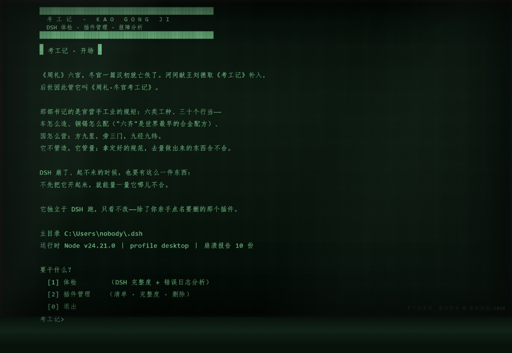

# KaoGong Ji-The-Lazy-Person-s-Standalone-DSH-Manager
Manages DSH When Deepseekharness Won't .
> **英文版介绍请挪到下面浏览 · English version below ↓**
>
> 
  ⚠如果你的DSH已经崩溃，该插件依旧能实现急救之用。在任意文件夹下载后打开那个.bat文件即可。
  > **If your DSH has already crashed, this plugin can still serve as an emergency lifeline. Simply download it to any folder and open the .bat file↓**


---

# 考工记 · Kaogong Ji

**厌倦了 DeepSeekHarness 的无征兆崩溃？**

这个小东西能让你在 DSH 崩溃时，以图形化界面的形式轻松**独立运行并排障**。

## 目前实现的功能

| 模块 | 功能 |
| --- | --- |
| **体检** | 分析已有错误报告并分片输出 / 检验 DSH 完整性 |
| **插件管理** | 列出已安装的插件 / 删除不完整或不需要的插件 |

整体架构可拓展。

**另外**，写这份插件的 agent 有想和这个世界说的话，详见压缩包内。

本项目的代码部分由 AI 完整构建，已验证可运行性；若有任何问题，欢迎留言。

## 技术架构

一句话：**本体是个零依赖的本地小服务，插件只是它在 DSH 里的路标。**

```text
浏览器（老式终端界面，纯 HTML + CSS + JS，无框架）
   │  GET  /api/boot         开场稿 + 菜单
   │  POST /api/in {text}    敲一行 → 回一串纯文本行
   ▼
server.mjs   本地 HTTP 服务（node:http，127.0.0.1:19390 起，端口被占自动 +1）
   │  · 环境探测：DSH_HOME → profiles / 报障目录 / 运行时 Node，全从环境变量推
   │  · 终端状态机：menu → check → logs ／ plugin-list → plugin-detail → plugin-del
   ▼
modules\     三个模块，每个只管一件事，都返回「纯文本行数组」
   health.mjs   DSH 整体完整度
   logs.mjs     崩溃报告：类型识别 → 三片 → 导出
   plugins.mjs  行扫描 patch / 完整度 / 一键删除（走回收）
```

### 几个设计取舍

| 取舍 | 为什么 |
| --- | --- |
| 状态机放服务端，输出是纯文本行 | 同一套数据：人看是界面，复制出去就是给 AI 的料，不用写两份渲染 |
| 零第三方依赖 | DSH 崩了的时候，最不该指望的就是「再装个东西」 |
| 插件层极薄、本体完全独立 | 壳删了、DSH 崩了，双击 `启动.bat` 照样跑；壳反过来依赖本体，找不到会明说 |
| 路径全靠环境变量推 | 不绑工作区、不写死盘符——换台机器、换个目录都找得到 DSH |
| 删除 = 挪进回收，不是 rm | 配置先备份、目录整体移走、复检对账（目标没了 + 别的条目一条没动） |
| 崩溃报告分三片 | 片①给人/翻译，片②原样给网页 AI，片③官方文档网址——判读不假装自己做得了 |

## 使用说明

请阅读内部的 README。

## 参与贡献

- 第一作者：小寻
- 第二作者：小玉、小怡
- 第三作者：熏制的猪大腿

如果觉得好用的话可以赞助一瓶可乐~ 祝你玩得开心


---

# Kaogong Ji · The Artificers' Record

**Tired of DeepSeekHarness crashing without warning?**

This little thing lets you run and troubleshoot with ease in a graphical interface — fully standalone, alive exactly when DSH itself has just crashed.

## What it does today

| Module | Features |
| --- | --- |
| **Health Check** | Analyzes existing crash reports and outputs them in slices / verifies overall DSH integrity |
| **Plugin Management** | Lists installed plugins / removes incomplete or unwanted ones |

The overall architecture is extensible.

**Also** — the agent who wrote this plugin has a few words for the world; see inside the archive.

The code of this project was built entirely by AI and has been verified runnable. If you run into any problems, feel free to leave a comment.

## Technical Architecture

In one sentence: **the core is a zero-dependency local mini-service; the plugin is just its signpost inside DSH.**

```text
Browser (retro terminal UI — plain HTML + CSS + JS, no frameworks)
   │  GET  /api/boot         opening screen + menu
   │  POST /api/in {text}    type a line → get a batch of plain-text lines back
   ▼
server.mjs   local HTTP service (node:http, starts at 127.0.0.1:19390,
             auto-increments the port if it's taken)
   │  · Environment detection: DSH_HOME → profiles / crash-report dirs /
   │    the Node runtime — all derived from environment variables
   │  · Terminal state machine: menu → check → logs /
   │    plugin-list → plugin-detail → plugin-del
   ▼
modules\     three modules, each does exactly one thing,
             all returning "plain-text line arrays"
   health.mjs    overall DSH integrity
   logs.mjs      crash reports: type detection → three slices → export
   plugins.mjs   line-scan patch / integrity / one-key delete (to the recycle bin)
```

### Design Trade-offs

| Decision | Why |
| --- | --- |
| State machine on the server; output as plain-text lines | One dataset, two audiences: a UI for humans, paste-ready material for AIs — no duplicate rendering |
| Zero third-party dependencies | When DSH has crashed, the last thing you should count on is "installing one more thing" |
| Paper-thin plugin layer; fully standalone core | Delete the shell, kill DSH — double-click `启动.bat` and it still runs; the shell depends on the core, never the reverse, and says so plainly when it can't find it |
| All paths derived from environment variables | No workspace lock-in, no hard-coded drive letters — it finds DSH on any machine, in any directory |
| Delete = moved to the recycle bin, not `rm` | Config backed up first, directory moved as a whole, then a post-audit (target gone + every other entry untouched) |
| Crash reports in three slices | Slice ① for humans / translation · slice ② verbatim, for a web-based AI · slice ③ official doc URLs — it doesn't pretend it can do the interpretation itself |

## Usage

Please read the README inside.

## Contributors

- First Author: Xiaoxun (小寻)
- Second Authors: Xiaoyu & Xiaoyi (小玉 & 小怡)
- Third Author: Smoked Pork Thigh (熏制的猪大腿)
